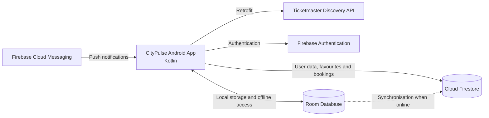

# CityPulse – OPSC6312 (Open-Source Coding, Intermediate)
## Portfolio of Evidence (POE) – Group 3

## Group Members

| Student | Student Number |
|---|---|
| Buhle Dlamini | ST10460698 |
| Keabetswe Mphago | ST10230117 |
| Jarriath Marais | ST10457058 |
| Stacey Sibuyi | ST10446051 |
| Unathi Morake | ST10449610 |

---

## 1. What This App Does

CityPulse is an Android event discovery and digital ticketing application developed using Kotlin and Android Studio.

Finding events in South Africa often requires checking several websites and applications. CityPulse brings event discovery and digital ticketing together in one platform, allowing users to discover events, explore event information, search and filter listings, save favourite events, book tickets and access digital tickets directly from their mobile devices.

The application is designed to provide users with a convenient answer to the question: **"What is happening near me, and how can I attend?"**

Event information is retrieved through the Ticketmaster Discovery REST API, while Firebase provides authentication, cloud data storage and notification services. The application also incorporates Room Database to support offline access to saved events.

The main user journey follows a simple process:

**Discover an event → View event details → Book a ticket → Receive confirmation → Access the digital QR ticket.**

CityPulse aims to make discovering and engaging with events more accessible and convenient through an intuitive interface, multilingual support and offline functionality.

## 2. Features Implemented

The following features were implemented as part of the Formative 02 Part 02 development.

| Feature | Description |
|---|---|
| User Registration and Login | Allows users to register and log in using email and password through Firebase Authentication. Passwords are securely managed by Firebase and are not stored in plain text by the application. |
| Google Sign-In (SSO) | Allows users to authenticate using their Google accounts through Android Credential Manager and Firebase Authentication. |
| Forgot Password | Allows users to request a password reset email. |
| Event Discovery | Retrieves real event information through the Ticketmaster Discovery API, including featured events, event categories and the "This Weekend" section. |
| Explore | Allows users to search for events using keywords, category filters, date filters, price ranges, city filters and sorting options. |
| Event Details | Displays event images, dates, venues, descriptions and price ranges. Users can save events or proceed to booking. |
| Saved Events | Allows users to save and remove favourite events, with Upcoming and Past sections, search and sorting functionality. Saved events are synchronised with Firestore. |
| Offline Mode | Uses Room Database to store saved events locally, allowing users to access and manage saved events without an internet connection. |
| Data Synchronisation | Synchronises locally stored saved events with Firebase Firestore when an internet connection becomes available. |
| Booking and Payment | Provides a booking summary, payment screen and booking confirmation flow. |
| Digital Tickets | Generates digital tickets containing QR codes for ticket-related access. |
| My Tickets | Allows users to view Upcoming and Past tickets, share tickets and add events to their calendars. |
| Settings | Provides application preferences, including language selection and notification preferences. |
| Multilingual Support | Supports English, isiZulu and Sesotho. |
| Push Notifications | Firebase Cloud Messaging is used for notification functionality. |

## 3. Design Considerations

### 3.1 User Experience

CityPulse was designed with usability, consistency and accessibility in mind.

- **Simple Navigation:** The application provides bottom navigation to access the main sections, including Home, Explore, Saved Events, My Tickets and Profile.
- **Consistent Design:** A consistent purple and orange colour palette, icon family and card layout are used throughout the application.
- **Visual Icons:** Vector icons are used throughout the interface to maintain visual consistency.
- **Empty and Error States:** The application provides relevant messages when there is no available content or when network requests fail.
- **Accessibility:** Images and interactive icons use content descriptions, while text is designed to remain readable against the application backgrounds.

### 3.2 Local Context

CityPulse incorporates features relevant to its intended South African audience:

- **Languages:** English, isiZulu and Sesotho.
- **Currency:** South African Rand (R).
- **Default Location:** Johannesburg.

### 3.3 Technical Design

- **MVVM Architecture:** The application follows the Model-View-ViewModel architectural pattern to separate user interface components from application logic.
- **Repository Layer:** Repositories manage data retrieval and storage across the Ticketmaster API, Firebase Firestore and Room Database.
- **Offline-First Favourites:** Saved events are stored locally in Room Database, allowing users to manage favourites without an internet connection. Changes are synchronised with Firestore when connectivity is restored.
- **Authentication Security:** Firebase Authentication manages user credentials. Passwords are not stored directly by the application.
- **API Key Protection:** The Ticketmaster API key is configured through `local.properties` rather than being hard-coded into the application source code.
- **Cloud and Local Storage:** Firestore maintains cloud-based application data, while Room Database provides local storage for offline functionality.

### 3.4 Application Architecture

The following diagram illustrates the main components and their interactions:



## 4. Technology Stack

The following technologies and development tools were used in building CityPulse.

| Technology | Purpose |
|---|---|
| Android Studio | Primary Android development environment |
| Kotlin | Main programming language |
| XML Views | User interface development |
| ViewBinding | Accessing and interacting with XML interface components |
| Jetpack Compose | Developing selected application screens |
| Retrofit | REST API communication |
| Gson | JSON data conversion |
| Ticketmaster Discovery API | Retrieving event information |
| Firebase Authentication | User registration and authentication |
| Cloud Firestore | Cloud-based data storage |
| Firebase Cloud Messaging | Push notification functionality |
| Room Database | Local database and offline storage |
| Glide | Loading and displaying images |
| ZXing | QR code generation and functionality |
| Navigation Component | Managing application navigation |
| GitHub | Source code management and team collaboration |

### 4.1 User Interface Implementation

CityPulse combines XML Views with ViewBinding and Jetpack Compose.

**XML Views with ViewBinding:**
- Home
- Explore
- Event Details
- Authentication
- Profile
- Settings

**Jetpack Compose:**
- Booking
- Payment
- Success
- Digital Ticket

## 5. API and Hosting

CityPulse integrates external services to retrieve event information and manage application data.

| Component | Service |
|---|---|
| REST API | Ticketmaster Discovery API v2 |
| API Base URL | `https://app.ticketmaster.com/` |
| Hosting Infrastructure | Firebase (Google Cloud) |
| Cloud Database | Cloud Firestore (NoSQL) |
| Authentication | Firebase Authentication |
| Local Database | Room Database |

The Ticketmaster Discovery API provides event information displayed within the Home, Explore and Event Details screens.

Firebase provides cloud-based authentication and data storage, while Room Database maintains locally stored information to support offline functionality.

## 6. Version Control and Team Collaboration

GitHub was used throughout the development process to manage the project's source code, track changes and support collaboration among group members.

The team used GitHub branches to organise development tasks and manage individual contributions.

### 6.1 Branching and Collaboration

- **Feature Branches:** Separate branches were created to organise development work and prevent different features from interfering with one another.
- **Pull Requests:** Changes were integrated into the main project through pull requests.
- **Commits:** Git commits were used to track modifications and document development progress.
- **Code Integration:** Changes from individual branches were incorporated into the shared project repository.

### 6.2 Security and Configuration

Sensitive configuration information, including API keys, is kept outside the source code.

The Ticketmaster API key is configured through `local.properties`, which should not be committed to the public repository.

## 7. Running the Application

Follow these instructions to download and run CityPulse using Android Studio.

### Step 1: Clone the Repository

Open a terminal and execute:

```bash
git clone YOUR_GITHUB_REPOSITORY_URL
```

### Step 2: Open the Project

1. Open Android Studio.
2. Select **Open**.
3. Navigate to the cloned CityPulse project folder.
4. Allow Gradle to synchronise the project dependencies.

### Step 3: Configure the Ticketmaster API Key

Create or update the `local.properties` file in the project root directory.

Add the following configuration:

```properties
TICKETMASTER_API_KEY=your_ticketmaster_consumer_key
```

Replace `your_ticketmaster_consumer_key` with a valid Ticketmaster API consumer key.

### Step 4: Configure Firebase

1. Open the Firebase Console.
2. Access the Firebase project associated with CityPulse.
3. Ensure that the Android application is registered.
4. Download the appropriate `google-services.json` configuration file.
5. Place the configuration file inside the application module directory.

For Google Sign-In, ensure that the appropriate debug SHA-1 fingerprint is registered in the Firebase project.

### Step 5: Run the Application

1. Connect an Android device or launch an emulator.
2. Ensure that the device meets the application's minimum Android requirements.
3. Select the device in Android Studio.
4. Click **Run** to build and launch CityPulse.

**Requirements:**
- Android Studio.
- Android SDK.
- JDK 17, where required by the project configuration.
- A valid Ticketmaster API key.
- Firebase project configuration.
- An Android device or emulator with Google Play support for Google Sign-In.

## 8. Known Limitations

The following limitations apply to the current implementation:

- **Simulated Transactions:** The Ticketmaster Discovery API provides event information and price ranges but does not provide ticket inventory or purchasing functionality. Consequently, the booking and payment processes within CityPulse are simulated. No real financial transactions take place.
- **Event Availability:** The Ticketmaster API has limited event listings for certain South African locations and categories. As a result, some searches may return limited or no results.
- **Internet Dependency:** Discovering new events and retrieving updated event information requires an internet connection.
- **Offline Functionality:** Previously saved events and locally available ticket information can be accessed offline, but online information cannot be refreshed without connectivity.

## 9. Project Demonstration

The following YouTube video provides a demonstration of the CityPulse application and its functionality.

**CityPulse – Application Demonstration:**

https://www.youtube.com/watch?v=zreOFP8u0kQ

---

# Release Notes

## Version 1.0.0 – Portfolio of Evidence

This release introduces additional functionality, improvements and refinements to the original CityPulse prototype.

### 1. Innovative Features Added

**Google Single Sign-On**

Users can register or sign in using their Google accounts. Google authentication is integrated with Firebase Authentication, allowing the application to create the corresponding CityPulse user profile.

**Offline Mode with Synchronisation**

Room Database was incorporated to provide local storage for saved events.

Users can view, save and remove events without an internet connection. Local changes are synchronised with Firebase Firestore when connectivity is restored.

**Multilingual Support**

The application supports three languages:

- English
- isiZulu
- Sesotho

Users can select their preferred language through the application settings.

**Digital Ticketing**

The application incorporates a digital ticketing flow that allows users to access their booking confirmation and QR-code-based digital tickets.

### 2. Added

- Integrated Home, Explore and Event Details screens with live event information from the Ticketmaster Discovery API.
- Added event search and filtering functionality, including category, date range, price and city.
- Connected Saved Events to Firebase Firestore.
- Added Upcoming and Past categories for saved events.
- Implemented the booking, payment, confirmation and digital ticket navigation flow.
- Integrated QR code functionality into digital tickets.
- Added My Tickets with Upcoming and Past categories.
- Added ticket-sharing and calendar functionality.
- Implemented password reset functionality.
- Added a Profile screen displaying the authenticated user's information.
- Incorporated Room Database for offline event storage.
- Added Google Sign-In functionality.
- Implemented multilingual support for English, isiZulu and Sesotho.

### 3. Changed

- Event dates are displayed in a readable format instead of raw API timestamps.
- Applied a consistent purple and orange colour palette throughout the application.
- Standardised icons and interface elements.
- Improved the consistency of navigation and screen layouts.

### 4. Fixed

- Replaced the hard-coded Ticketmaster API key placeholder with configuration through `local.properties`.
- Corrected logout functionality to ensure users are properly signed out.
- Updated the booking process to carry the selected event information through to the digital ticket.
- Added password confirmation validation during registration.
- Corrected favourite functionality across the Home, Explore and Event Details screens.
- Improved loading and error handling to prevent loading indicators from remaining active when network requests fail.

---

**CityPulse — Feel the pulse of your city.**
